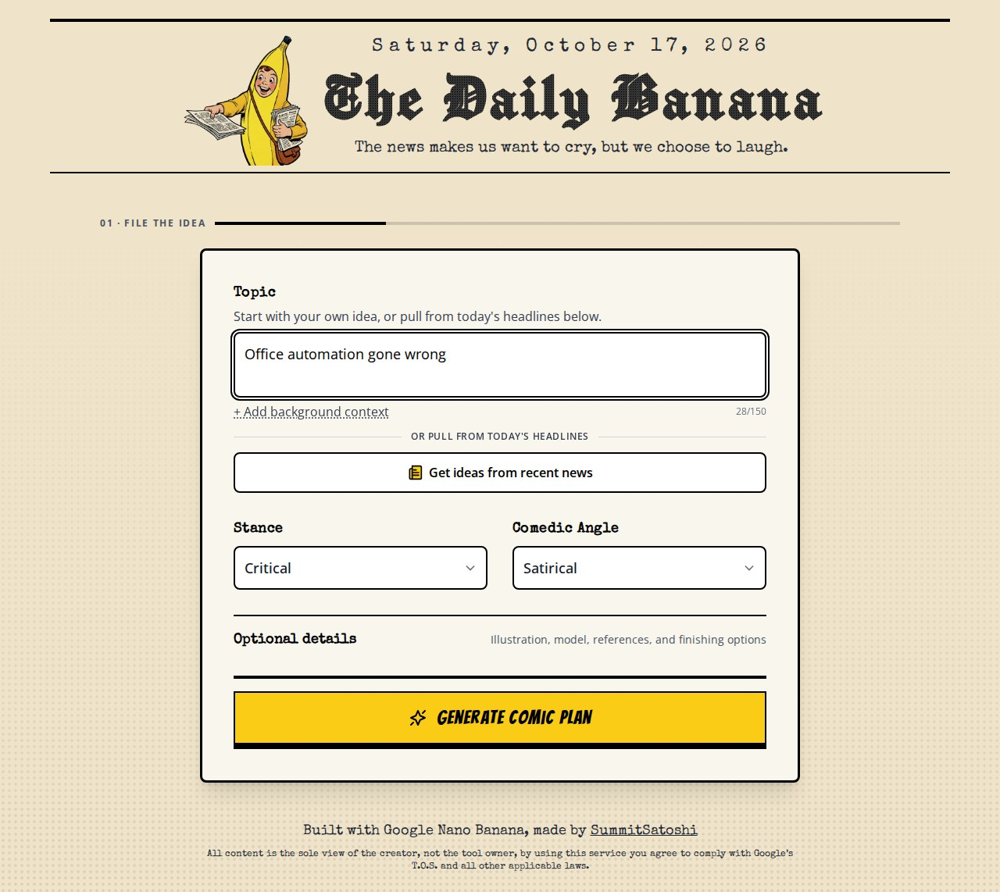
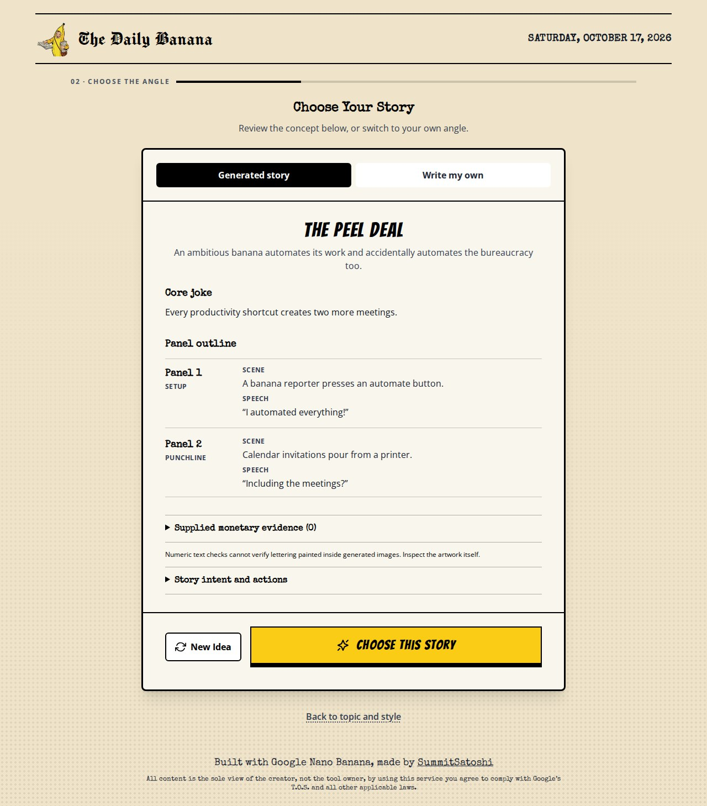
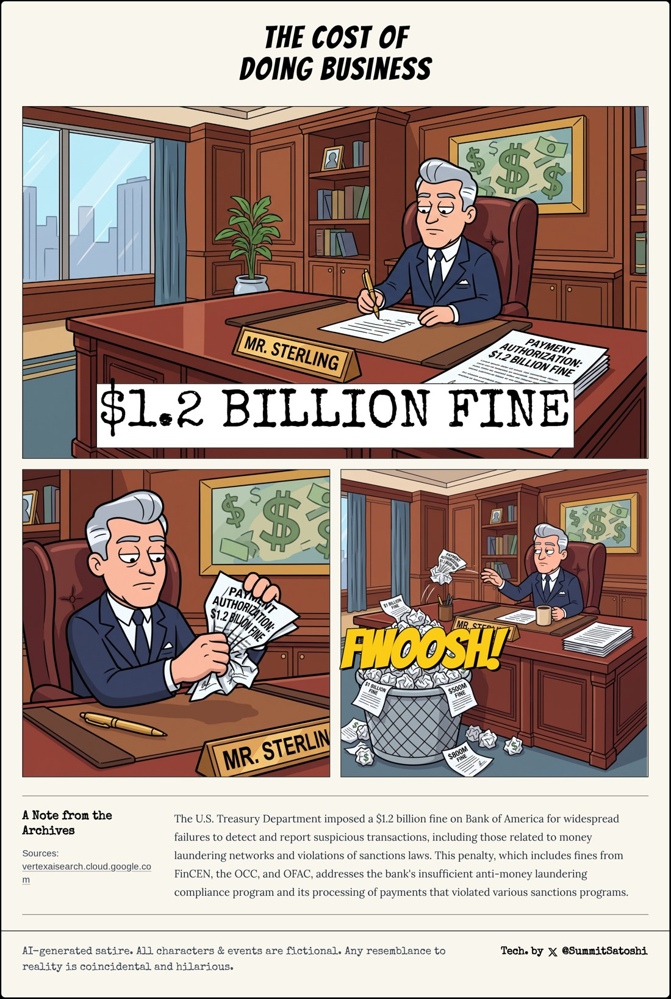

# The Daily Banana 🍌

*A small newsroom for turning an idea into an editable comic.*

> The news makes us want to cry, but we choose to laugh.

**[Make a comic →](https://whatifqu3stion.github.io/daily-banana/)** · Bring your own Gemini API key. Generation is billed to your Google project.

The Daily Banana is a creative AI prototype: start with a topic or a sourced headline, find the angle, review the opening panel, and shape the finished strip. The interesting design challenge is giving someone enough control to make the comic feel like their own, while keeping the process approachable.

Started as a hackathon project from a Google AI Studio export, it has grown through AI-assisted development and iteration on the workflow, visual direction, prompts, and error handling. It remains a prototype with open questions about usability and output quality.

## A look around the newsroom

<p align="center">
  
  <br><sub><b>File the idea.</b> Topic, stance, and comedic angle come first. Illustration styles, references, and other controls sit behind optional details.</sub>
</p>

<p align="center">
  
  <br><sub><b>Find the angle.</b> Read the joke and panel outline before committing to artwork. Keep the idea, ask for another, or write your own angle.</sub>
</p>

<table>
  <tr>
    <td align="center" width="32%"></td>
    <td align="center" width="68%"></td>
  </tr>
  <tr>
    <td><b>A smaller newsroom.</b> Inputs stack on phones, with large controls and the same visual identity.</td>
    <td><b>An earlier edition.</b> A saved generated comic from the repository. Its text, artwork, and factual claims still need editorial review.</td>
  </tr>
</table>

The interface captures use a scripted story to show the real UI without paid generation. The saved comic is a separate, earlier output. [Capture notes and provenance](docs/portfolio/README.md).

## What I wanted the experience to do

A comic has several things to get right at once: a recognizable subject, a clear joke, readable dialogue, and characters that stay recognizable from panel to panel. A successful image request only solves part of that problem.

The workflow breaks those decisions into four stages: **file the idea → choose the angle → proof the first panel → make the edition.** Each stage gives the creator something concrete to judge.

| Design decision | Reasoning and tradeoff |
| --- | --- |
| A newspaper identity | The masthead, paper tones, halftone texture, and banana-yellow actions carry the editorial joke into the interface. Readable body type balances the more expressive headings. |
| Essential controls first | Topic, stance, and humor establish the creative brief. Optional details preserve depth without making every choice mandatory. Whether this is the right balance still needs user testing. |
| A story choice before artwork | The premise and panel outline make the model's interpretation visible. A custom-angle route lets the creator redirect it. |
| A first-panel proof | The creator can inspect the style and opening beat in context. Later panels may already generate in the background to reduce waiting, which can spend credits on a direction they later change. |
| Local edits and recovery | Text can be edited and bubbles repositioned. A weak or failed image can be regenerated or refined on its own, preserving the rest of the strip. |
| Key setup outside the workspace | A missing key opens a contextual route into settings. Credential management stays separate from story decisions. BYOK makes the demo shareable, but adds friction for first-time visitors. |

## The tricky parts have been useful

**Continuity is more than matching a character.** Later images reference the first panel and nearby artwork, alongside recurring character tags and a shared set description. Edits flag downstream continuity for human review. These are consistency aids; they do not guarantee that a pose, prop, or action is correct.

**A good-looking strip can still tell a confusing story.** The planner records an anchor, a satirical argument, setup, payoff, and action states. Review controls expose that intent so a creator can catch a missing causal beat. The next test is whether people can understand the joke without an explanation from its maker.

**Satire needs room to invent, while source amounts need care.** Supplied monetary claims are tracked separately, with checks for changed amounts and approval for rounding before artwork. A later archive note is kept distinct from the original brief. These checks cover structured text; they cannot verify lettering painted inside an image or establish that a source is true. [Story quality notes](docs/comic-generation-quality.md) · [Numeric consistency notes](docs/numeric-source-consistency.md).

**Generation is slow, fallible, and billable.** Progress states, per-panel errors, stale-request protection, and shared in-flight panel work help preserve useful progress. Transport failures are surfaced without automatic retries; completed image responses with no image have a bounded retry path. Refinement and regeneration incur further usage.

## Under the press

React, TypeScript, Vite, Tailwind CSS, the Google GenAI SDK, and html-to-image for PNG export.

| Part | Responsibility |
| --- | --- |
| [App.tsx](App.tsx) and [components](components) | Stage navigation, accessible dialogs, story review, and editing |
| [useComicGeneration.ts](hooks/useComicGeneration.ts) | Generation state, reference flow, background work, and recovery |
| [geminiService.ts](services/geminiService.ts) | Structured plans, image direction, and optional archive context |
| [storyContract.ts](services/storyContract.ts) and [numericFacts.ts](services/numericFacts.ts) | Story-intent and supplied-amount checks |
| [geminiConnection.ts](services/geminiConnection.ts) | Connection state and the choice of browser or backend transport |
| [Pages workflow](.github/workflows/pages.yml) | Build, offline checks, and deployment |

### Two ways to run it

**GitHub Pages:** a static BYOK build. Requests go directly from the visitor's browser to Google. A key is entered at runtime, retained in tab memory for up to 30 minutes, and cleared on refresh, close, or removal. It is not embedded in the build or saved to browser storage. Browser scripts and extensions may access it while in use. Billing, model access, and quotas belong to the visitor's Google project.

**Node-hosted version:** the existing same-origin backend retains the supplied key in a temporary server session and forwards requests to Google. GitHub Pages cannot run that server. See [deployment notes](docs/deployment.md).

```bash
npm ci
npm run dev
```

Open the displayed local URL and connect a key through API settings. No publisher API key or `.env.local` credential is required. Secure session cookies require HTTPS; `npm run dev -- --local-test-http` is available for plain HTTP loopback development.

```bash
npm run build:pages   # static BYOK build in dist/
npm run build        # frontend for the Node-hosted version
npm start            # serve that build and its backend
```

## What is verified, and what comes next

The publishing pass checks the production Pages build with the real SDK and intercepted Google responses, plus the existing server and UI tests. It exercises the four-stage flow, key handling, asset paths, and sourced-news selection. Those checks establish application behavior, not the quality or availability of live Google output. No paid generation was run for this pass.

The next useful research is a small task-based trial: can a new creator connect a key, make a strip, explain its joke, and improve one weak panel without help? I want to observe where they hesitate, which controls they use, whether the output feels worth refining, and how much time and API usage it takes to reach a comic they would share. There are no measured adoption, usability, or quality results claimed here yet.
