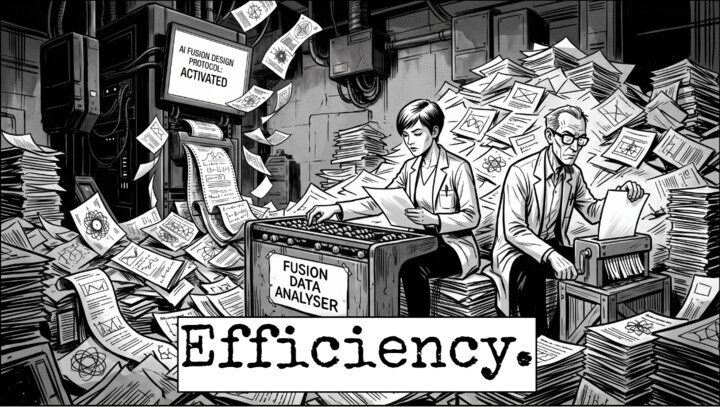
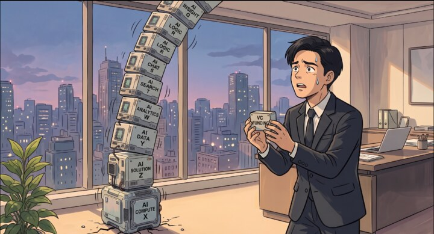

# The Daily Banana 🍌

*A small newsroom for turning an idea into an editable comic.*

> The news makes us want to cry, but we choose to laugh.

**[Make a comic](https://whatifqu3stion.github.io/daily-banana/)** · [Install and run The Daily Banana](#install-and-run-the-daily-banana)

Making an AI image is one thing. Making a comic with a point, a joke, and characters who still look like themselves in the next panel is another. I wanted to explore that gap, while giving people room to make the result their own.

The Daily Banana starts with a topic or sourced headline and takes it through a story outline, an opening-panel review, and an editable strip. It began as a hackathon project from a Google AI Studio export, received award recognition, and has grown through AI-assisted development. It remains a prototype, not a guarantee of good comedy.

**Bring your own Gemini API key.** Requests use your Google project's access, quota, and billing.

## A couple of editions

<p align="center">
  <a href="docs/portfolio/data-deluge-fusion-edition.png"></a>
  <a href="docs/portfolio/the-vc-jenga-tower.png"></a>
</p>

**Data Deluge: Fusion Edition** turns promised efficiency into a mountain of paperwork. **The VC Jenga Tower** takes financial dependence rather literally. Select either crop to see the full comic. These are finished exports, separate from the staged interface example below.

## From idea to comic

<table>
  <tr>
    <td width="50%"><br><strong>1. Set the brief.</strong> Start with the topic and angle. References, models, and illustration settings stay available without crowding the first step.</td>
    <td width="50%"><br><strong>2. Choose the story.</strong> Read the joke before paying to illustrate it. Accept the outline, request another, or supply your own angle.</td>
  </tr>
  <tr>
    <td><br><strong>3. Review the opening panel.</strong> Compare the image with the plan, then refine or regenerate it.</td>
    <td><br><strong>4. Edit the strip.</strong> Change the words, move bubbles, revise individual images, and export a PNG.</td>
  </tr>
</table>

*The actual interface with a scripted story and saved artwork; no new generation was run for these captures. [Examples and capture notes](docs/portfolio/README.md).*

## Decisions and things I've learned

**The interface should invite an idea, not an afternoon of configuration.** The newspaper identity gives the app some character: paper tones, halftone texture, a masthead, and banana-yellow actions. Essential story choices come first. Optional references include a note about what to preserve, so an image can guide a character, object, or style rather than serve as unexplained decoration.

**A small edit should stay small.** Dialogue and captions are separate from the artwork. Rewriting a line or moving a bubble needs no image request, and one weak panel can be revised without rebuilding the strip. Lettering already painted into an image is still part of that image.

**More checks can make a worse experience.** An early source-number review interrupted comic-making with approvals. That became one optional notice, keeping concerns inspectable without blocking editing or export. It compares text; it is not independent fact-checking. [Quality notes](docs/comic-generation-quality.md) · [Source-number checks](docs/numeric-source-consistency.md).

**Funny isn't a formula.** Structure and visual consistency help, but neither guarantees that a joke lands. I want to watch new users make a strip, improve one weak panel, and share it with someone who hasn't heard the explanation. That research is still ahead.

## How the app is put together

React and TypeScript handle the interface; Vite and Tailwind CSS handle the build and styling. Google's GenAI SDK handles generation, and html-to-image exports the finished comic.

The [generation hook](hooks/useComicGeneration.ts) coordinates a multi-step job rather than one request. A structured story plan becomes individual panels. References and previous artwork carry context forward; dialogue remains a separate editable layer. Shared in-flight work, per-panel recovery, and stale-response protection keep a failed or outdated request from undoing useful progress.

There is a cost tradeoff: later panels can generate while you review the first. That reduces waiting, but changing direction may discard billable work. News suggestions retain source links, and later research stays separate from the original brief so it is clear what informed each stage.

The public GitHub Pages build calls Google directly. A supplied key stays in tab memory for up to 30 minutes and clears on refresh, close, or removal; page scripts and extensions may access it during use. The Node-hosted version instead uses temporary server sessions. Neither requires a publisher-funded fallback key. [Deployment and key handling](docs/deployment.md).

## Install and run The Daily Banana

You need Git, npm, and a Node.js version allowed by the [`engines` field](package.json). Node 24.22.1 or a later 24.x release satisfies the current requirement.

1. **Clone the project and open its folder.**

   ```bash
   git clone https://github.com/whatifqu3stion/daily-banana.git
   cd daily-banana
   ```

2. **Install dependencies.**

   ```bash
   npm ci
   ```

3. **Start the local development server.**

   ```bash
   npm run dev -- --local-test-http
   ```

   This flag permits plain HTTP on loopback for local testing. Production requires HTTPS.

4. **Open the local URL printed in the terminal.** Add your Gemini key through **API settings**, then enter a topic. No key belongs in a committed file or `.env.local`.

For static hosting, use `npm run build:pages`. For the Node-hosted production version, use `npm run build` followed by `npm start`. See the [deployment guide](docs/deployment.md) for configuration and validation commands.

Automated server and browser checks cover the workflow, key handling, asset paths, and news selection using simulated provider responses. They check application behavior, not whether live output is funny or worth sharing. Usability and output-quality results have not yet been measured.
