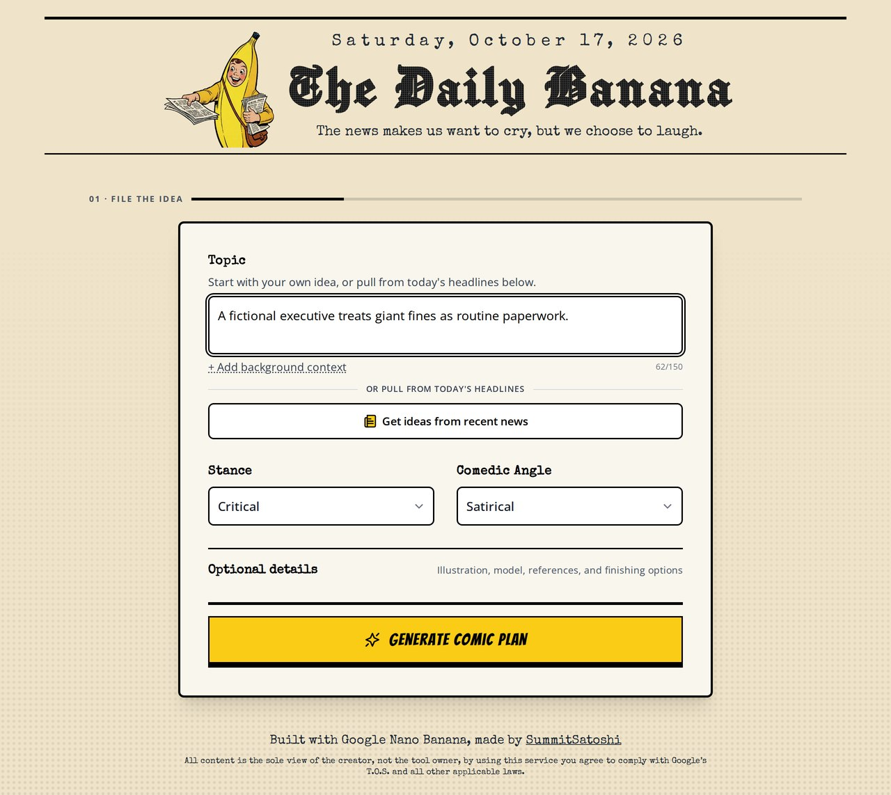
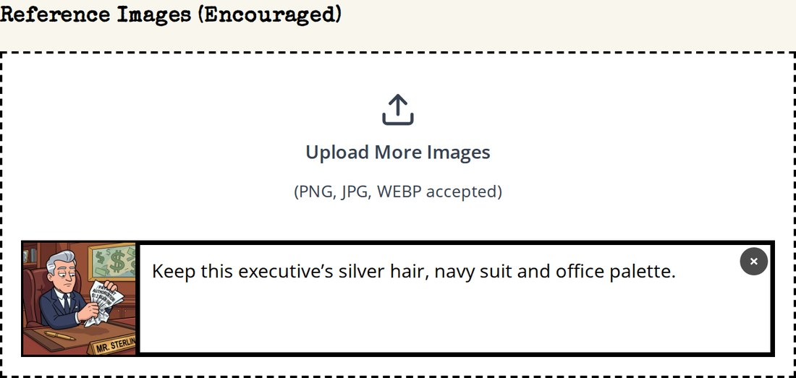
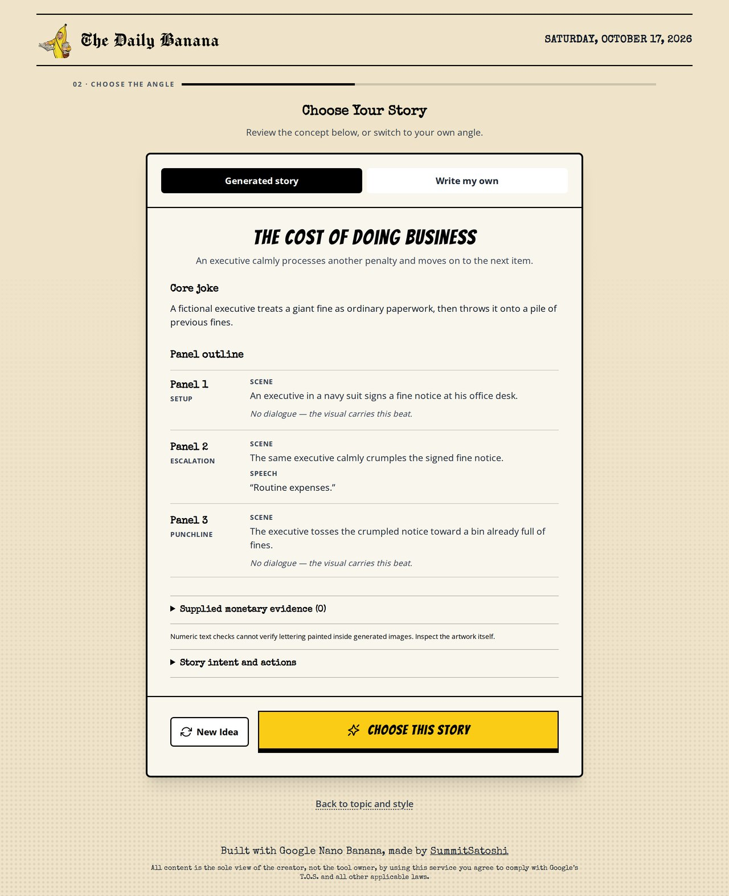
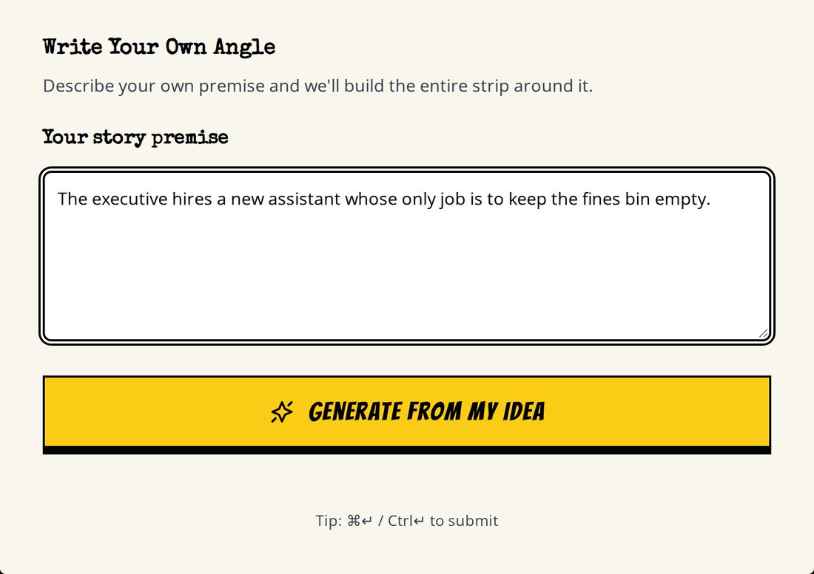
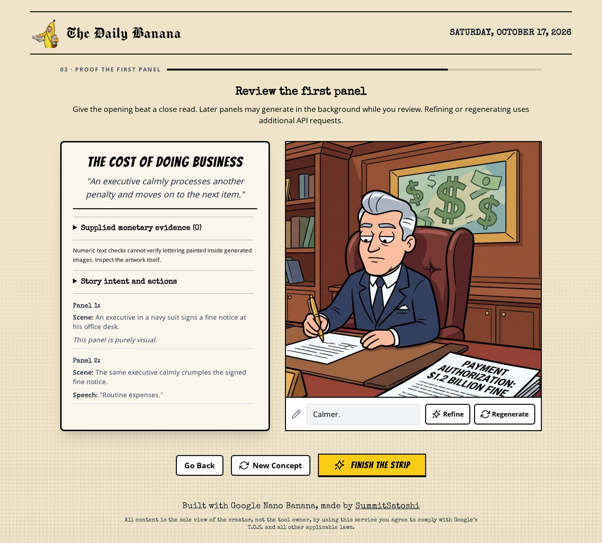
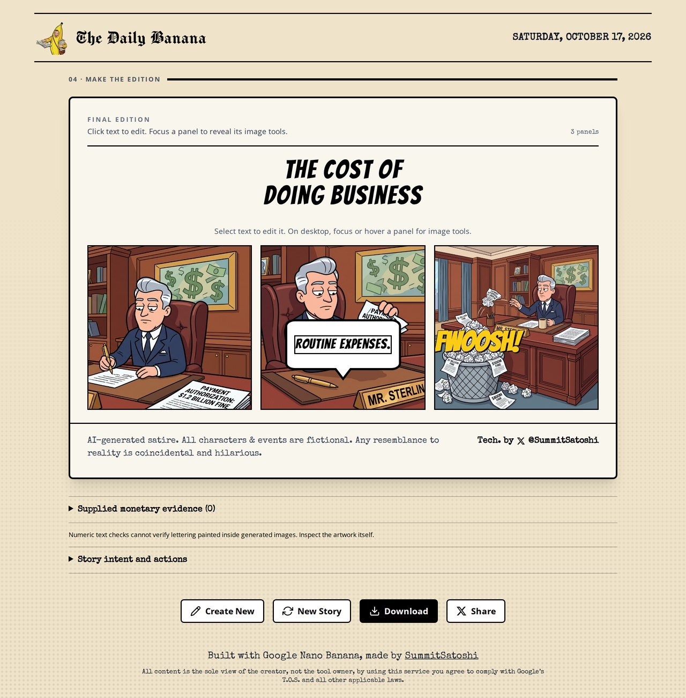
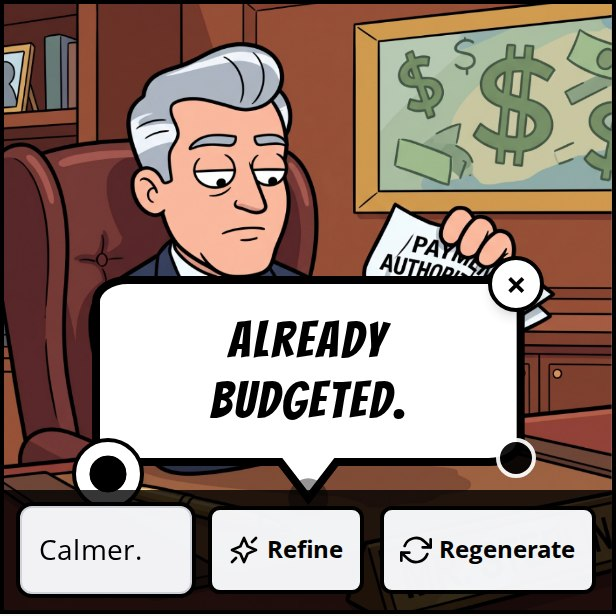
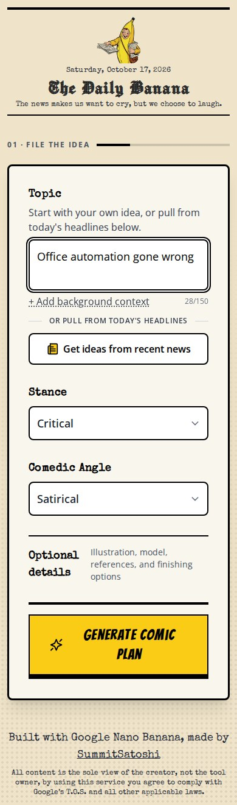

# The Daily Banana 🍌

*A small newsroom for turning an idea into an editable comic.*

> The news makes us want to cry, but we choose to laugh.

**[Make a comic →](https://whatifqu3stion.github.io/daily-banana/)** · Bring your own Gemini API key. Generation is billed to your Google project.

The Daily Banana is a creative AI prototype: start with a topic or a sourced headline, find the angle, review the opening panel, and shape the finished strip. The interesting design challenge is giving someone enough control to make the comic feel like their own, while keeping the process approachable.

Started as a hackathon project from a Google AI Studio export, it has grown through AI-assisted development and iteration on the workflow, visual direction, prompts, and error handling. It remains a prototype with open questions about usability and output quality.

## From idea to edition

Follow one fictional comic, **The Cost of Doing Business**, through the desktop workflow. These are captures of the real interface using a scripted plan and saved prototype artwork; no new AI generation was run for this walkthrough. [Capture notes](docs/portfolio/README.md).

### 1. File the idea

<p align="center">
  
</p>

**Start with the editorial brief.** Enter a topic or use recent news, then choose a stance and comedic angle. The main screen keeps those decisions prominent; illustration style, image references, model selection, and finishing options are available under Optional details. Generate Comic Plan moves the creator into story selection.

**Closer look: give the artwork a visual starting point.**

<p align="center">
  
</p>

An uploaded reference can guide a character, object, or style. The accompanying note specifies what should carry over: here, the executive's silver hair, navy suit, and office palette. That makes the reference's intended role explicit, while leaving its interpretation to the model.

### 2. Choose the angle

<p align="center">
  
</p>

**Judge the idea before the artwork.** Read the core joke and panel outline, then choose the story, request a new idea, or return to the brief. This checkpoint exposes how the model interpreted the topic, giving the creator a chance to redirect the story before image requests begin.

<details>
  <summary><b>Closer look: write an original angle</b></summary>
  <p align="center">
    
  </p>
  <p>The Write my own tab makes room for a specific premise. A creator can describe the joke they want, then ask the planner to build around it. This keeps authorship available alongside the generated suggestion. The alternative shown here is entered but not submitted.</p>
</details>

### 3. Proof the first panel

<p align="center">
  
</p>

**Compare intention with the image.** Inspect the opening scene alongside the plan, add a focused instruction, and use Refine for an edit or Regenerate for another attempt. Finish the strip moves into the full editor. Later panels can already generate in the background during review, so changing direction can spend credits on work the creator chooses not to keep.

### 4. Shape the finished strip

<p align="center">
  
</p>

**Read it as a complete comic.** Check the sequence, dialogue, and visual continuity together. Text and its placement remain editable; focusing or hovering a panel reveals its image tools. The creator can refine a weak panel while preserving the rest, then download a clean PNG with the editor controls omitted.

**Closer look: revise the wording while keeping the artwork.**

<p align="center">
  
</p>

The dialogue changes from **“Routine expenses.”** to **“Already budgeted.”** through a real text edit, with the same artwork retained. Text and placement changes are local; Refine and Regenerate request new artwork and use API credits. Lettering already painted inside an image remains part of that image. [View the exported walkthrough comic](docs/portfolio/walkthrough-export.jpg).

<details>
  <summary><b>A smaller newsroom: the mobile layout</b></summary>
  <p align="center">
    
  </p>
  <p>Inputs stack on phones, with large controls and the same visual identity. This earlier capture uses a separate office-automation example; the walkthrough above follows the desktop journey.</p>
</details>

## What I wanted the experience to do

A comic has several things to get right at once: a recognizable subject, a clear joke, readable dialogue, and characters that stay recognizable from panel to panel. A successful image request only solves part of that problem.

The workflow breaks those decisions into four stages: **file the idea → choose the angle → proof the first panel → make the edition.** Each stage gives the creator something concrete to judge.

| Design decision | Reasoning and tradeoff |
| --- | --- |
| A newspaper identity | The masthead, paper tones, halftone texture, and banana-yellow actions carry the editorial joke into the interface. Readable body type balances the more expressive headings. |
| Essential controls first | Topic, stance, and humor establish the creative brief. Optional details preserve depth without making every choice mandatory. Whether this is the right balance still needs user testing. |
| A story choice before artwork | The premise and panel outline make the model's interpretation visible. A custom-angle route lets the creator redirect it. |
| A first-panel proof | The creator can inspect the style and opening beat in context. Later panels may already generate in the background to reduce waiting, which can spend credits on a direction they later change. |
| Local edits and recovery | Text can be edited and bubbles repositioned. A weak or failed image can be regenerated or refined on its own, preserving the rest of the strip. |
| Key setup outside the workspace | A missing key opens a contextual route into settings. Credential management stays separate from story decisions. BYOK makes the demo shareable, but adds friction for first-time visitors. |

## The tricky parts have been useful

**Continuity is more than matching a character.** Later images reference the first panel and nearby artwork, alongside recurring character tags and a shared set description. Edits flag downstream continuity for human review. These are consistency aids; they do not guarantee that a pose, prop, or action is correct.

**A good-looking strip can still tell a confusing story.** The planner records an anchor, a satirical argument, setup, payoff, and action states. The outline exposes that intent so a creator can catch a missing causal beat. The next test is whether people can understand the joke without an explanation from its maker.

**Satire needs room to invent, while source amounts need care.** An early checking pass required source bindings, rounding approvals, and review acknowledgments. Creator feedback showed that it interrupted the fun of making a comic. Concerns now sit in one optional notice: ordinary rounding stays quiet, and larger differences can be inspected without blocking creation, editing, or export. Supplied figures and later research retain separate provenance. These are text comparisons, not independent fact verification or inspection of painted lettering. [Story quality notes](docs/comic-generation-quality.md) · [Numeric consistency notes](docs/numeric-source-consistency.md).

**Generation is slow, fallible, and billable.** Progress states, per-panel errors, stale-request protection, and shared in-flight panel work help preserve useful progress. Transport failures are surfaced without automatic retries; completed image responses with no image have a bounded retry path. Refinement and regeneration incur further usage.

## Under the press

React, TypeScript, Vite, Tailwind CSS, the Google GenAI SDK, and html-to-image for PNG export.

| Part | Responsibility |
| --- | --- |
| [App.tsx](App.tsx) and [components](components) | Stage navigation, accessible dialogs, story review, and editing |
| [useComicGeneration.ts](hooks/useComicGeneration.ts) | Generation state, reference flow, background work, and recovery |
| [geminiService.ts](services/geminiService.ts) | Structured plans, image direction, and optional archive context |
| [storyContract.ts](services/storyContract.ts) and [numericFacts.ts](services/numericFacts.ts) | Story-intent and supplied-amount checks |
| [geminiConnection.ts](services/geminiConnection.ts) | Connection state and the choice of browser or backend transport |
| [Pages workflow](.github/workflows/pages.yml) | Build, offline checks, and deployment |

**A bounded news lookup.** Recent-news suggestions use Gemini 2.5 Flash with Google Search and a 1,024-token thinking budget. The request aims for an even U.S./international mix with short snippets, and the app keeps stories only when it can attach sources from Google's grounding metadata. Both transports allow 60 seconds for Google and 75 seconds overall. These are initial waiting limits to validate against live usage, not measured response-time guarantees. Timeouts offer a manual retry rather than automatically making another potentially billable request. The browser retains the latest lookup's duration and outcome in the `daily-banana:news-lookup` Performance entry, without keys or story content.

### Two ways to run it

**GitHub Pages:** a static BYOK build. Requests go directly from the visitor's browser to Google. A key is entered at runtime, retained in tab memory for up to 30 minutes, and cleared on refresh, close, or removal. It is not embedded in the build or saved to browser storage. Browser scripts and extensions may access it while in use. Billing, model access, and quotas belong to the visitor's Google project.

**Node-hosted version:** the existing same-origin backend retains the supplied key in a temporary server session and forwards requests to Google. GitHub Pages cannot run that server. See [deployment notes](docs/deployment.md).

```bash
npm ci
npm run dev
```

Open the displayed local URL and connect a key through API settings. No publisher API key or `.env.local` credential is required. Secure session cookies require HTTPS; `npm run dev -- --local-test-http` is available for plain HTTP loopback development.

```bash
npm run build:pages   # static BYOK build in dist/
npm run build        # frontend for the Node-hosted version
npm start            # serve that build and its backend
```

## What is verified, and what comes next

The publishing pass checks the production Pages build with the real SDK and intercepted Google responses, plus the existing server and UI tests. It exercises the four-stage flow, key handling, asset paths, and sourced-news selection. Those checks establish application behavior, not the quality or availability of live Google output. No paid generation was run for this pass.

The next useful research is a small task-based trial: can a new creator connect a key, make a strip, explain its joke, and improve one weak panel without help? I want to observe where they hesitate, which controls they use, whether the output feels worth refining, and how much time and API usage it takes to reach a comic they would share. There are no measured adoption, usability, or quality results claimed here yet.
